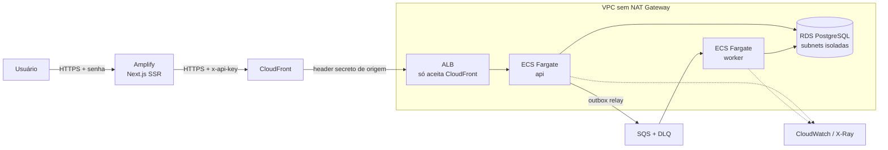

# mini-banco

[](https://github.com/paulohfsantos/mini-bank/actions/workflows/ci.yml)

> **English summary.** A small accounts-and-transfers system built with the practices of a corporate bank: idempotent transfers, transactional outbox to SQS, deterministic lock ordering in raw SQL, money as integer cents, and Spec-Driven Development (every acceptance criterion has a test that cites its ID). Stack: NestJS + Next.js (TypeScript, ESM), PostgreSQL, SQS, OpenTelemetry, and AWS (ECS Fargate, RDS, CloudFront, Amplify) provisioned with Terraform. The AWS lab comes up and is destroyed by a single command. Docs are in Portuguese.

Laboratório de contas e transferências, pequeno de propósito, construído com as práticas de um banco corporativo. Cada decisão está documentada e pode ser explicada: **por que** foi tomada, quais alternativas havia e o que fica como débito.

## Destaques

- **Transferência correta sob concorrência:** `Idempotency-Key` na mesma transação, locks em ordem determinística (`idempotency_keys` → contas por `id`), `lock_timeout`/`statement_timeout` em toda transação, dinheiro em centavos `bigint`.
- **Integração assíncrona confiável:** Transactional Outbox → SQS → worker idempotente (antifraude + notificação), com DLQ e redrive.
- **Spec-Driven Development:** spec → contrato OpenAPI → testes → código. **72/72 critérios de aceite** cobertos por testes que citam o ID (`[TRF-AC-06] ...`), verificado no CI.
- **Testes em três níveis:** unitário (Vitest), integração com Postgres e SQS reais (Testcontainers), e2e validado contra o `openapi.yaml`, mais o fluxo no navegador (Playwright).
- **Segurança desde o desenho:** 36 riscos mapeados (`SEC-xx`) antes do código; as mitigações têm testes que citam o ID. TLS ponta a ponta, RDS sem rota para a internet, segredos só no Secrets Manager, containers sem root.
- **AWS como código:** Terraform em módulos com `terraform test`, tflint e trivy no CI. `./scripts/lab.sh up` sobe o ambiente em ~15 min (migration, deploy e smoke tests); `down` destrói tudo e confere que nada ficou cobrando.
- **Observabilidade:** logs JSON com `correlationId`, traces OpenTelemetry da API ao worker (Jaeger local, X-Ray na AWS) e métricas de baixa cardinalidade.

## Arquitetura na AWS



Detalhes, fluxo de uma transferência ponta a ponta e o desenho local em [`docs/README.md`](docs/README.md).

## Stack

| Camada | Tecnologia |
|---|---|
| Back end | NestJS 12 (ESM), arquitetura hexagonal, zod, pino |
| Front end | Next.js (App Router, Server Components/Actions; a API key nunca vai ao browser) |
| Dados | PostgreSQL com SQL puro (`pg`, sem ORM), migrations dbmate |
| Mensageria | SQS com Transactional Outbox (ElasticMQ local) |
| Observabilidade | OpenTelemetry, Jaeger, AWS X-Ray (ADOT), CloudWatch |
| Infraestrutura | Terraform, ECS Fargate ARM64, RDS, CloudFront, ALB, Amplify, Secrets Manager |
| Qualidade | Vitest, Testcontainers, Supertest, Playwright, ESLint, Spectral, GitHub Actions |

## Status

| Fase | | |
|---|---|---|
| 0–1 | Fundação, specs e contratos | ✅ |
| 2–3 | API de contas e transferências; outbox, SQS e worker | ✅ |
| 4–5 | Front Next.js; observabilidade local | ✅ |
| 6 | Infraestrutura AWS com Terraform (aplicada e destruída por comando) | ✅ |
| 7 | CI/CD com GitHub Actions e OIDC | ⏳ próxima |
| 8–10 | Observabilidade na AWS, game days de troubleshooting, hardening | ⏳ |

## Débitos conscientes

Num laboratório, alguns trade-offs são escolhas documentadas, não esquecimentos:

- **Sem autenticação de usuário final:** quem tem a API key acessa qualquer conta (BOLA, `SEC-03`). Em produção: OAuth2/OIDC e autorização por recurso.
- **Sem NAT Gateway:** as tasks têm IP público (sem portas abertas) para evitar o custo fixo; em produção, subnets privadas com VPC endpoints.
- **Antifraude pós-fato:** uma transferência marcada como suspeita já foi concluída.

A lista completa está em [`docs/risks.md`](docs/risks.md).

## Rodar localmente

Pré-requisitos: Node 26 (`.nvmrc`), pnpm 12, Docker.

```bash
./start.sh        # install → infra local → migrations → todos os testes → web :3000, api :3001, worker :3002
```

Ou passo a passo (`pnpm infra:up`, `pnpm db:migrate`, `pnpm dev`): ver [`docs/README.md`](docs/README.md#9-como-rodar-localmente). Traces em http://localhost:16686 (Jaeger).

## Documentação

- [`docs/README.md`](docs/README.md): domínio, competências demonstradas, arquitetura, fluxos
- [`docs/plan.md`](docs/plan.md): fases, tarefas e critérios de pronto
- [`docs/aws.md`](docs/aws.md): infraestrutura, IAM, custos, sessão do lab
- [`docs/risks.md`](docs/risks.md): riscos de segurança e performance com mitigações
- [`docs/adr/`](docs/adr/): decisões arquiteturais
- [`specs/`](specs/): specs por feature, `openapi.yaml`, schema dos eventos
- [`CLAUDE.md`](CLAUDE.md): instruções para a IA (fluxo SDD e checklist de revisão humana)
