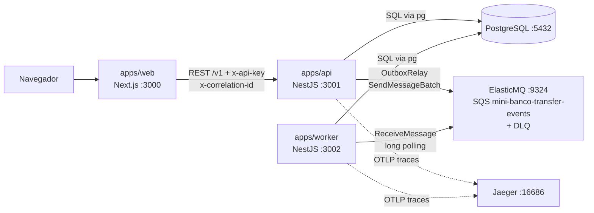
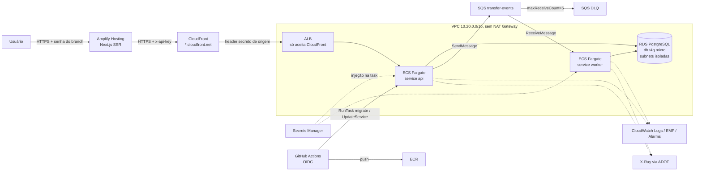
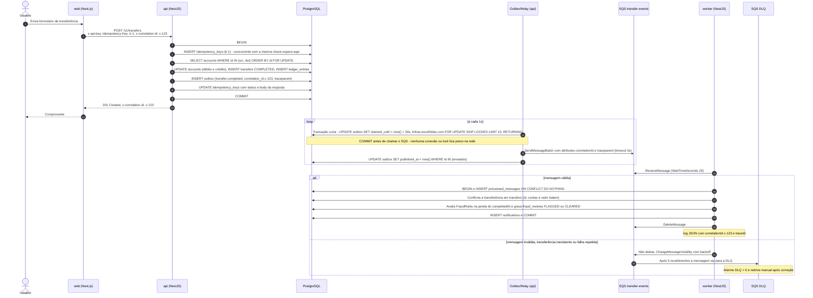
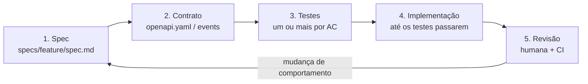

# mini-banco

Laboratório Full Stack + AWS + Spec-Driven Development (SDD). É um sistema de contas e transferências pequeno de propósito, mas construído com as práticas de um banco corporativo. Cada decisão aqui deve poder ser explicada em entrevista técnica.

> **Status:** fase de documentação. Ainda não há código de aplicação nem infraestrutura. O plano de execução está em [`plan.md`](./plan.md) e a infraestrutura AWS em [`aws.md`](./aws.md).

---

## 1. Objetivo

Preparar para uma vaga de **Desenvolvedor Full Stack / AI em banco**. O projeto demonstra, com código real e verificável:

- TypeScript de ponta a ponta: Next.js (App Router) no front e NestJS no back.
- Arquitetura hexagonal, SOLID e APIs REST com contrato versionado.
- PostgreSQL com transações, locks e concorrência tratados de forma explícita.
- Integração síncrona (REST) e assíncrona (SQS + DLQ + Transactional Outbox).
- Testes em três níveis, cada um rastreável a um critério de aceite.
- AWS de ponta a ponta: Terraform, ECS Fargate, RDS, SQS, IAM com least privilege, CloudWatch, X-Ray e GitHub Actions com OIDC.
- Uso disciplinado de IA no desenvolvimento, guiado por specs.

## 2. Requisito da vaga → onde aparece no projeto

| Requisito da vaga | Onde aparece no projeto |
|---|---|
| TypeScript + React/Next.js | `apps/web`: App Router, Server Components, Server Actions chamando a API pelo servidor (a API key nunca vai ao browser) |
| NestJS | `apps/api` (HTTP) e `apps/worker` (consumer SQS), com módulos, providers, guards, pipes e interceptors |
| Orientação a objetos e SOLID | Camadas `domain` / `application` / `infrastructure`; ports (interfaces) como `AccountRepository` e `EventPublisher` com adapters Postgres (SQL puro via `pg`) e SQS; regras antifraude como estratégias (`FraudRule`), o que é Open/Closed na prática |
| APIs REST | `specs/openapi.yaml`, versionamento `/v1`, erros em RFC 9457 (`application/problem+json`), `Idempotency-Key`, paginação por cursor |
| Arquitetura de software | ADRs em `docs/adr/`, arquitetura hexagonal, outbox, separação api/worker |
| Testes automatizados | Jest (unitário), Supertest (e2e), Testcontainers (Postgres e ElasticMQ/SQS reais); cada teste cita o ID do critério (ex.: `TRF-AC-06`) |
| PostgreSQL | SQL puro (sem ORM) com `pg` e queries parametrizadas, migrations `.sql` versionadas com dbmate, `SELECT ... FOR UPDATE` em ordem determinística, `CHECK (balance_cents >= 0)`, `FOR UPDATE SKIP LOCKED` no outbox, índices para keyset pagination |
| Integração síncrona e assíncrona | `POST /v1/transfers` síncrono; evento `transfer.completed` via outbox → SQS → worker |
| IA aplicada ao desenvolvimento | `CLAUDE.md`, fluxo spec → testes → código, decomposição por fase, revisão humana obrigatória (seção 8) |
| Spec-Driven Development | `specs/<feature>/spec.md`, `specs/openapi.yaml`, `specs/events/`, critérios Dado/Quando/Então com IDs |
| AWS: implantação | Terraform (`infra/`), ECS Fargate, ECR, RDS, Amplify Hosting |
| AWS: IAM | Execution role e task role separadas por serviço, role do GitHub via OIDC, `iam:PassRole` restrito (ver `aws.md`) |
| AWS: integração | SQS + DLQ com redrive policy, Secrets Manager injetado na task, SSM Parameter Store |
| AWS: observabilidade | CloudWatch Logs (JSON), métricas EMF, alarmes, dashboard, X-Ray via ADOT/OpenTelemetry |
| AWS: troubleshooting | Fase 9 com game days: IAM negado, DLQ, secret errado, health check, security group, idempotência concorrente |
| Segurança | Análise de riscos prévia em [`risks.md`](./risks.md) (`SEC-xx`/`PERF-xx`), least privilege, secrets fora do código, validação de entrada, rate limiting, headers de segurança, TLS ponta a ponta (CloudFront → ALB, `verify-full` no RDS), scan de dependências e imagens |
| Resiliência | Outbox, retries com backoff, DLQ, consumer idempotente, health checks de liveness e readiness |
| CI/CD | GitHub Actions: lint → testes → build → push ECR → migration (task ECS one-off) → deploy ECS, sem access keys de longa duração |

## 3. Domínio

### 3.1 Funcionalidades

| Funcionalidade | Endpoint / componente | Spec |
|---|---|---|
| Criar conta | `POST /v1/accounts` | `specs/accounts/spec.md` |
| Consultar conta e saldo | `GET /v1/accounts/{accountId}` | `specs/accounts/spec.md` |
| Transferir | `POST /v1/transfers` (header `Idempotency-Key` obrigatório) | `specs/transfers/spec.md` |
| Consultar transferência | `GET /v1/transfers/{transferId}` | `specs/transfers/spec.md` |
| Extrato paginado | `GET /v1/accounts/{accountId}/statement?limit=20&cursor=...` | `specs/statement/spec.md` |
| Publicação do evento | `OutboxRelay` (dentro de `apps/api`) | `specs/transfer-processing/spec.md` |
| Antifraude e notificação | `apps/worker` consumindo `transfer.completed` | `specs/transfer-processing/spec.md` |
| Health | `GET /health/live`, `GET /health/ready` | requisito não funcional |

### 3.2 Regras centrais

- Valores monetários sempre em **centavos, inteiro**. No Postgres são `bigint`; no domínio, `Money` usa `bigint`; na borda HTTP/JSON viram `number` após checagem de `Number.isSafeInteger`, porque `JSON.stringify` não serializa `BigInt` (`PERF-09`). Nunca `float`.
- Tetos no contrato: `amountCents` ≤ `100_000_000` (R$ 1.000.000,00) por transferência e saldo inicial ≤ `10_000_000` (R$ 100.000,00). Isso evita overflow e limita a "impressora de dinheiro" do saldo inicial livre (`SEC-05`, `SEC-06`).
- Transferência é **atômica**: débito, crédito, registro da transferência, lançamentos no ledger, registro no outbox e resposta de idempotência são gravados no **mesmo commit**.
- Ordem fixa de locks: primeiro a linha de `idempotency_keys`, depois as contas com `SELECT ... FOR UPDATE` **em ordem crescente de `id`**. Isso evita deadlock entre transferências A→B e B→A simultâneas. O `CHECK (balance_cents >= 0)` é a última linha de defesa.
- Toda transação tem `SET LOCAL lock_timeout = '2s'` e `statement_timeout = '5s'`. Em uma conta muito disputada, a requisição falha rápido com `503` + `Retry-After` em vez de esgotar o pool de conexões (`PERF-06`).
- `Idempotency-Key` é obrigatório (UUID ou até 64 caracteres). A mesma chave com o mesmo payload devolve a resposta original (`Idempotent-Replayed: true`). A mesma chave com payload diferente devolve `422`. Se a requisição original ainda estiver em andamento e a espera passar do `lock_timeout`, a resposta é `409 REQUEST_IN_PROGRESS` com `Retry-After` (`PERF-07`).
- O evento `transfer.completed` é entregue **pelo menos uma vez** (at-least-once). Por isso o worker é idempotente (tabela `processed_messages`) e **não confia cegamente no evento**: confirma que a transferência existe em `transfers`, com os mesmos valores, antes de agir (`SEC-14`).
- Antifraude simples, com regras versionadas:
  - `HIGH_AMOUNT`: valor ≥ `1_000_000` centavos (R$ 10.000,00).
  - `HIGH_VELOCITY`: 5 ou mais transferências da mesma conta de origem na janela `[completedAt - 10min, completedAt]`. A janela é relativa ao horário da transferência, **não a `now()`**, para que um backlog na fila não distorça a regra (`PERF-20`).
  - Resultado `FLAGGED` ou `CLEARED` em `fraud_reviews`. A transferência já está `COMPLETED`; a revisão é pós-fato, como um monitoramento transacional.
- Notificação simulada: registro em `notifications` + log estruturado, para remetente e destinatário.

### 3.3 Modelo de dados (resumo)

| Tabela | Colunas principais | Observações |
|---|---|---|
| `accounts` | `id uuid`, `holder_name`, `document` (CPF, unique), `balance_cents bigint`, `created_at`, `updated_at` | `CHECK (balance_cents >= 0)` |
| `transfers` | `id uuid`, `source_account_id`, `destination_account_id`, `amount_cents bigint`, `status`, `correlation_id`, `created_at` | `CHECK (amount_cents > 0)`, `CHECK (source <> destination)`, status `COMPLETED`; índices `(source_account_id, created_at)` para a regra de velocidade e em `destination_account_id` (o Postgres não indexa FKs sozinho) |
| `ledger_entries` | `id`, `account_id`, `transfer_id null`, `type` (`OPENING`/`DEBIT`/`CREDIT`), `amount_cents`, `balance_after_cents`, `created_at` | Base do extrato; índice `(account_id, created_at desc, id desc)` |
| `idempotency_keys` | `client_id`, `key`, `request_hash`, `transfer_id`, `response_status`, `response_body jsonb`, `created_at`, `expires_at` | PK `(client_id, key)` |
| `outbox` | `id uuid`, `aggregate_id`, `event_type`, `payload jsonb`, `correlation_id`, `traceparent`, `created_at`, `claimed_until null`, `published_at null`, `attempts`, `last_error` | Índice parcial `WHERE published_at IS NULL`; linhas publicadas há mais de 7 dias são apagadas por um job de limpeza (`PERF-12`) |
| `fraud_reviews` | `id`, `transfer_id unique`, `status` (`FLAGGED`/`CLEARED`), `reasons text[]`, `rule_version`, `created_at` | Escrita só pelo worker |
| `notifications` | `id`, `transfer_id`, `account_id`, `type`, `channel` (`LOG`), `created_at` | Unique `(transfer_id, account_id, type)` |
| `processed_messages` | `consumer`, `event_id`, `processed_at` | PK `(consumer, event_id)` garante idempotência |

O ledger existe porque o saldo em `accounts` é desnormalizado para leitura rápida. Um teste de invariante verifica que `SUM(ledger) = balance_cents` para toda conta, que é o tipo de reconciliação que bancos fazem.

IDs são **UUIDv7** gerados na aplicação: ordenados por tempo, o que evita inserções aleatórias no B-tree (`PERF-10`). `idempotency_keys` expiradas também são apagadas pelo job de limpeza.

### 3.4 Fora de escopo (débitos conscientes)

- **Autenticação de usuário final.** A API exige `x-api-key` (um cliente: o servidor Next.js). Não há login nem autorização por titular, então qualquer chamador com a key vê qualquer conta (BOLA, `SEC-03`). Como o site é público, ele fica atrás da **proteção por senha do branch no Amplify** e só existe durante a sessão de estudo (`SEC-01`). Em produção: OAuth2/OIDC, escopos e autorização por recurso (ADR-0012).
- **Saldo inicial livre** (com teto) em vez de depósito vindo de fora do sistema (`SEC-05`).
- **Antifraude pós-fato:** uma transferência `FLAGGED` já foi concluída (`SEC-07`).
- A lista completa de riscos aceitos e mitigados está em [`risks.md`](./risks.md).
- Sem multimoeda, tarifas, limites diários ou estorno.
- Banco compartilhado entre api e worker (com usuários de banco distintos). Em microsserviços reais, cada serviço teria seu banco ou schema.

## 4. Arquitetura

### 4.1 Local

Tudo roda sem conta AWS: Postgres, ElasticMQ (SQS compatível; ADR-0022) e Jaeger via `docker-compose`, e as aplicações via `pnpm dev`.



### 4.2 AWS (visão geral; detalhes em [`aws.md`](./aws.md))



## 5. Fluxo de uma transferência ponta a ponta

O `correlationId` nasce no front (ou na API, se o header não vier), volta no header de resposta, é gravado na linha do `outbox`, viaja como **message attribute** no SQS junto com o `traceparent` (W3C Trace Context) e aparece em todos os logs do worker.



Pontos que valem explicar em entrevista:

1. **Por que outbox e não `sqs.send` dentro do handler?** Publicar antes do commit pode gerar um evento de transferência que não existiu (rollback). Publicar depois do commit pode perder o evento se o processo cair entre o commit e o envio. Com o outbox, o evento faz parte do commit.
2. **Por que o consumer precisa ser idempotente?** O relay pode cair entre `SendMessage` e `UPDATE published_at`, e o SQS Standard também pode entregar duplicado. Então a entrega é at-least-once e a deduplicação acontece no consumidor.
3. **Por que travar as contas em ordem?** Dois locks em ordem inversa causam deadlock. Com ordem total por `id`, um sempre espera o outro.
4. **Por que o relay faz "claim" e não envia dentro da transação?** Se o `SendMessageBatch` rodasse com os locks `SKIP LOCKED` abertos, um SQS lento prenderia conexões do pool e travaria a API (`PERF-04`). Com `claimed_until`, a transação é curta, e se o relay cair depois do claim a linha volta a ser elegível quando o prazo expira.

## 6. Estrutura de pastas do monorepo

```text
mini-banco/
├── CLAUDE.md                     # instruções para IA (criado na fase 0)
├── package.json                  # scripts raiz
├── pnpm-workspace.yaml
├── docker-compose.yml            # postgres, elasticmq (SQS), jaeger
├── .github/workflows/
│   ├── ci.yml                    # lint, typecheck, testes, scans
│   └── deploy.yml                # OIDC → ECR → migrate → ECS
├── apps/
│   ├── web/                      # Next.js App Router
│   │   └── src/app/{accounts,transfers}/...
│   ├── api/                      # NestJS HTTP + OutboxRelay
│   │   ├── src/modules/{accounts,transfers,statement,outbox,health}/
│   │   │   ├── domain/           # entidades, value objects (Money, Cpf), regras
│   │   │   ├── application/      # use cases + ports
│   │   │   └── infrastructure/   # controllers, repositórios SQL (pg), adapter SQS
│   │   └── test/{e2e,integration}/
│   └── worker/                   # NestJS standalone consumer SQS
│       └── src/modules/{transfer-processing,fraud,notifications}/
├── db/
│   ├── migrations/               # NNNN_descricao.sql (dbmate: -- migrate:up / -- migrate:down)
│   └── schema.sql                # dump gerado pelo dbmate, versionado para revisão de diff
├── packages/
│   ├── database/                 # Pool pg, UnitOfWork, parsers de tipo (int8 → bigint), helpers de transação
│   ├── contracts/                # zod schemas + tipos gerados do openapi.yaml + schema de eventos
│   ├── observability/            # logger pino, correlationId (AsyncLocalStorage), bootstrap OTel
│   └── config/                   # eslint, tsconfig base, prettier
├── specs/
│   ├── openapi.yaml
│   ├── events/transfer.completed.v1.schema.json
│   ├── accounts/spec.md
│   ├── transfers/spec.md
│   ├── statement/spec.md
│   └── transfer-processing/spec.md
├── infra/
│   ├── bootstrap/                # recursos persistentes: state, OIDC, ECR, budgets
│   ├── envs/lab/                 # ambiente efêmero: apply/destroy por sessão
│   └── modules/                  # network, alb, ecs-service, rds, sqs, ...
├── scripts/                      # check-local-infra.sh, session-end-check.sh
└── docs/
    ├── README.md
    ├── plan.md
    ├── aws.md
    ├── risks.md                  # riscos SEC-xx / PERF-xx
    ├── adr/NNNN-titulo.md
    └── runbooks/                 # game days (fase 9)
```

## 7. Fluxo de trabalho SDD (spec primeiro)



1. **Spec.** `specs/<feature>/spec.md` com: contexto, regras de negócio (`TRF-BR-01`...), contrato (link para `openapi.yaml#/paths/...` ou schema do evento), critérios de aceite Dado/Quando/Então (`TRF-AC-01`...), casos de erro e requisitos não funcionais (`TRF-NFR-01`, ex.: p95 < 300 ms local).
2. **Contrato.** `specs/openapi.yaml` (OpenAPI 3.1) é a fonte de verdade da API REST. `specs/events/transfer.completed.v1.schema.json` (JSON Schema) é a fonte de verdade do evento. Os tipos TypeScript em `packages/contracts` são gerados a partir desses arquivos (`openapi-typescript`), e os schemas zod são validados contra os exemplos do contrato em teste.
3. **Testes.** Cada critério vira ao menos um teste, e o ID aparece no nome:
   ```ts
   it('[TRF-AC-06] mesma Idempotency-Key em paralelo gera uma única transferência', ...)
   ```
   Um script de CI (`pnpm specs:coverage`) extrai os IDs das specs e falha se algum AC não tiver teste.
4. **Código.** Só depois. Os testes e2e validam as respostas reais contra `openapi.yaml` (teste de contrato), então código e contrato não divergem em silêncio.
5. **Decisões.** Registradas em `docs/adr/NNNN-titulo.md` (contexto, opções, decisão, consequências).

Uma mudança de comportamento segue sempre a ordem **spec → contrato → testes → código**, de preferência no mesmo PR, e a revisão começa pelo diff da spec.

## 8. Fluxo de trabalho com IA

A IA (Claude Code) é tratada como um par rápido que não tem contexto implícito. O fluxo foi desenhado para que o resultado seja verificável, e não apenas plausível.

| Etapa | O que acontece | Artefato |
|---|---|---|
| **Contexto** | `CLAUDE.md` descreve arquitetura, comandos, convenções e o fluxo SDD. A IA lê a spec e o contrato da feature antes de qualquer código. | `CLAUDE.md`, `specs/` |
| **Decomposição** | Cada fase do `plan.md` é quebrada em tarefas pequenas (um use case, um adapter, uma migration), cada uma com testes próprios. | checklist no `plan.md` |
| **Testes primeiro** | A IA gera os testes a partir dos ACs (com IDs) e eles falham. Só então implementa. | `*.spec.ts`, `test/e2e` |
| **Agentes** | Subagentes para tarefas isoladas: explorar código, revisar um diff, rodar os testes e resumir as falhas. O agente principal mantém o plano. | sessão do Claude Code |
| **Escolha de modelo** | Modelo mais capaz para desenho, concorrência, SQL de lock e revisão; modelo mais rápido e barato para tarefas mecânicas (boilerplate, renomeações, fixtures). | convenção no `CLAUDE.md` |
| **Validação** | `pnpm lint && pnpm typecheck && pnpm test` obrigatórios antes de dar uma tarefa por concluída; cobertura de ACs (`pnpm specs:coverage`). | CI |
| **Revisão humana** | Ao final de cada tarefa, a IA lista **o que precisa de revisão humana**: SQL de lock e isolamento, políticas IAM, tratamento de dinheiro, segurança, desvios da spec. | descrição do PR |

Regras explícitas para a IA (vão para o `CLAUDE.md`):

- Não alterar comportamento sem antes alterar a spec, e não editar a spec e o código no mesmo passo sem avisar.
- Não usar `float` para dinheiro e não usar `any` em código de domínio.
- Não ampliar permissões IAM com `*` sem justificativa escrita.
- Não marcar uma tarefa como pronta com teste falhando ou pulado (`.skip`).
- Mensagens de commit referenciam os IDs (`feat(transfers): idempotency key [TRF-AC-04, TRF-AC-05]`).

Por que isso importa em entrevista: mostra que a IA acelera a produção, mas a **garantia de correção vem da spec, dos testes e da revisão**, não da confiança no texto gerado.

## 9. Como rodar localmente (esboço; o código ainda não existe)

Pré-requisitos: Node.js LTS, pnpm, Docker.

```bash
pnpm install
pnpm infra:up                     # postgres, elasticmq (filas + DLQ de infra/local/elasticmq.conf), jaeger
pnpm infra:check                  # verifica tudo, inclusive a redrive policy
pnpm db:migrate                   # dbmate up em db/migrations
pnpm dev                          # web :3000, api :3001, worker :3002

# Swagger (servindo specs/openapi.yaml): http://localhost:3001/docs
# Jaeger:                               http://localhost:16686

pnpm test                         # unit
pnpm test:integration             # Testcontainers (precisa de Docker)
pnpm test:e2e                     # Supertest
pnpm specs:coverage               # todo AC tem teste?
```

Exemplo de chamada:

```bash
curl -X POST http://localhost:3001/v1/transfers \
  -H 'x-api-key: local-dev-key' \
  -H 'Idempotency-Key: 6f1c2a8e-0000-4000-8000-000000000001' \
  -H 'Content-Type: application/json' \
  -d '{"sourceAccountId":"...","destinationAccountId":"...","amountCents":15000}'
```

> **Por que ElasticMQ e não LocalStack:** a imagem atual do LocalStack exige auth token. Como só usamos SQS localmente, o ElasticMQ (open source, sem conta) cobre fila, DLQ com `maxReceiveCount` e `StartMessageMoveTask` (ADR-0022).

## 10. ADRs planejadas (criadas na fase 0)

| ADR | Decisão (opções → escolha) |
|---|---|
| 0001 | Registrar decisões com ADRs no formato MADR curto |
| 0002 | Monorepo: pnpm workspaces puro vs Nx vs Turborepo → **pnpm workspaces** (mais simples; Turborepo pode entrar depois para cache) |
| 0003 | Arquitetura: camadas vs hexagonal → **hexagonal por módulo** (ports no `application`, adapters no `infrastructure`) |
| 0004 | Acesso a dados: Prisma vs TypeORM vs SQL puro → **SQL puro com `pg` (node-postgres)**, sem ORM: cada query, lock (`FOR UPDATE`, `SKIP LOCKED`) e transação fica explícito e revisável; repositórios mapeiam linhas para objetos de domínio à mão. Custos aceitos: mais código de mapeamento e tipagem das linhas garantida por testes de integração, não pelo compilador |
| 0005 | Validação: class-validator vs zod → **zod** em `packages/contracts`, compartilhado por api, worker e web; `openapi.yaml` continua sendo a fonte do contrato e a coerência é garantida por teste |
| 0006 | Publicação de eventos: envio direto vs outbox (polling ou CDC) → **outbox com polling, claim por `claimed_until` + `SKIP LOCKED` e envio fora da transação** (CDC com Debezium seria caro e pesado para o lab; `PERF-04`) |
| 0007 | Fila: SQS Standard vs FIFO → **Standard + DLQ**: ordem global não é necessária e o consumer já é idempotente |
| 0008 | Idempotência: tabela no Postgres vs Redis → **tabela `idempotency_keys` na mesma transação** (atomicidade sem infraestrutura extra) |
| 0009 | Dinheiro: `bigint` em centavos + ledger de lançamentos |
| 0010 | Tracing: X-Ray SDK vs OpenTelemetry → **OpenTelemetry** no código; local exporta para Jaeger e na AWS o sidecar ADOT exporta para X-Ray. É vendor-neutral, e a AWS indica OpenTelemetry/ADOT para instrumentação nova (conferir o status atual dos SDKs X-Ray) |
| 0011 | Logs: pino JSON + `correlationId` via `AsyncLocalStorage` |
| 0012 | Autenticação: API key fixa de laboratório (débito consciente) |
| 0013 | Rede: sem NAT Gateway; subnets públicas para ALB/tasks e subnets isoladas para RDS |
| 0014 | Front: Amplify Hosting (SSR) vs S3+CloudFront (export estático) → **Amplify**, porque o SSR mantém a API key no servidor |
| 0015 | Estado Terraform: S3 + DynamoDB vs S3 com lock nativo → **S3 com `use_lockfile`** (Terraform ≥ 1.10) |
| 0016 | Paginação: offset vs cursor (keyset) → **cursor** por `(created_at, id)`. Limitação documentada: um lançamento que commita depois com `created_at` anterior pode não aparecer para quem já passou daquela posição (`PERF-14`) |
| 0017 | Região: `us-east-1` vs `sa-east-1` → **`us-east-1`** (custo; ver `aws.md`) |
| 0018 | Compute: Fargate x86 vs ARM64 → **ARM64 (Graviton)**, mais barato por vCPU-hora |
| 0019 | Migrations: Flyway vs node-pg-migrate vs dbmate → **dbmate**: arquivos `.sql` puros com up/down, binário único (disponível via npm), roda igual no local, nos testes e na task ECS. Flyway seria a escolha comum em banco, mas traz a JVM para um projeto Node. Regras: `SET lock_timeout` em toda migration, `CREATE INDEX CONCURRENTLY` com `-- migrate:up transaction:false` e mudanças expand/contract (`PERF-15`) |
| 0020 | Banco: RDS vs Postgres gerenciado fora da AWS (Supabase, Neon) → **RDS**. Com o ambiente efêmero, o RDS custa ~US$ 0,06 por sessão de 3 h (~US$ 0,75/mês com 12 sessões); é menor que o ALB e os IPv4 públicos. Fora da AWS se perderiam subnets isoladas, SG app → banco, senha master gerenciada e rotacionada pelo RDS no Secrets Manager, migration dentro da VPC, game day de SG e alarmes RDS. O banco ficaria exposto na internet (só senha), as conexões diretas do Supabase são IPv6 (a VPC é só IPv4) e o pooler em modo transação limita recursos de sessão. Supabase faria sentido só se fosse preciso manter dados entre sessões sem pagar RDS 24×7, e aqui um seed resolve isso. Valores aproximados; conferir preços e limites atuais |
| 0021 | TLS sem domínio: HTTP direto no ALB vs domínio + ACM vs **CloudFront na frente do ALB** → **CloudFront** (certificado `*.cloudfront.net` gratuito). O ALB só aceita o prefix list de origem do CloudFront e exige um header secreto de origem; sem o header, a resposta é 403 (`SEC-02`). Com domínio próprio, ACM no ALB vira opção |
| 0022 | SQS local: LocalStack (exige auth token nas versões atuais) vs ElasticMQ → **ElasticMQ**: open source, sem conta nem segredo no CI, sobe rápido; cobre fila, DLQ com `maxReceiveCount` e `StartMessageMoveTask` (verificado). Paridade fina com o SQS real é coberta pelos testes no ambiente `lab` |
