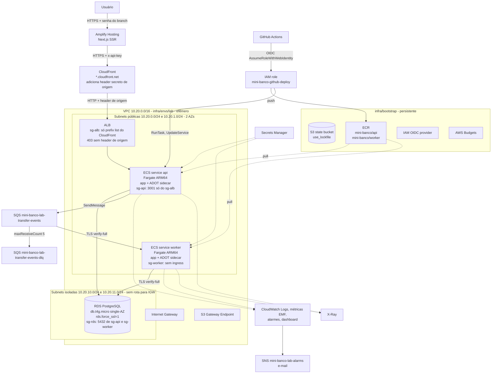

# Infraestrutura AWS: mini-banco

> Ambiente de **laboratório**, efêmero e de baixo custo. Sobe no início da sessão de estudo com `terraform apply` e é destruído no fim com `terraform destroy`. **Preços são aproximados** e precisam ser conferidos antes de usar (§6).

Região recomendada: **`us-east-1`** (justificativa em §7.4).

---

## 1. Diagrama da infraestrutura



As tasks saem para a internet pelo Internet Gateway usando IP público (sem NAT) para falar com ECR, SQS, Secrets Manager, CloudWatch e X-Ray. Os layers de imagem do ECR vêm do S3 pelo **S3 Gateway Endpoint** (gratuito).

---

## 2. Recursos

### 2.1 Persistentes (`infra/bootstrap`): sobrevivem ao destroy diário

| Recurso | Nome | Motivo | Configuração mínima |
|---|---|---|---|
| S3 (state) | `mini-banco-tfstate-<account-id>` | State remoto compartilhável, versionado e recuperável | Versioning, SSE-S3, Block Public Access, `prevent_destroy` |
| Lock do state | lockfile no próprio S3 | Evitar dois `apply` simultâneos | `use_lockfile = true` (Terraform ≥ 1.10). O lock via DynamoDB é a forma antiga e está depreciada no backend S3; só seria necessária em versões anteriores |
| IAM OIDC provider | `token.actions.githubusercontent.com` | Federar o GitHub Actions sem access keys | `client_id_list = ["sts.amazonaws.com"]` |
| IAM role | `mini-banco-github-deploy` | Deploy pelo CI | §3.4 |
| ECR | `mini-banco/api`, `mini-banco/worker` | Imagens sobrevivem entre sessões (evita rebuild a cada apply) | `image_tag_mutability = IMMUTABLE`, scan on push, lifecycle: manter 10 imagens |
| AWS Budgets | `mini-banco-monthly` | Alerta de gasto | Limite mensal de US$ 15; alertas em 50%, 80% e 100% real e 100% previsto, por e-mail |
| Cost Anomaly Detection | monitor por serviço | Detectar recurso esquecido | Alerta diário por e-mail |

### 2.2 Efêmeros (`infra/envs/lab`): criados e destruídos por sessão

| Recurso | Nome | Motivo | Configuração mínima |
|---|---|---|---|
| VPC | `mini-banco-lab` | Isolamento de rede | `10.20.0.0/16`, DNS hostnames on |
| Subnets públicas | `public-a`, `public-b` | ALB exige 2 AZs; tasks com IP público (sem NAT) | `/24` cada, rota `0.0.0.0/0 → IGW` |
| Subnets isoladas | `isolated-a`, `isolated-b` | RDS sem rota para a internet (subnet group exige 2 AZs) | `/24` cada, route table sem IGW |
| Internet Gateway | `mini-banco-lab-igw` | Saída das tasks e entrada no ALB | — |
| S3 Gateway Endpoint | — | Pull de layers do ECR sem passar pela internet; sem custo | Associado à route table pública |
| Security groups | `sg-alb`, `sg-api`, `sg-worker`, `sg-rds` | Firewall por função | `sg-alb`: porta 80 só do managed prefix list `com.amazonaws.global.cloudfront.origin-facing` (o prefix list conta como várias regras na cota do SG; conferir o peso atual). `sg-api`: 3001 só de `sg-alb`. `sg-worker`: sem ingress. `sg-rds`: 5432 só de `sg-api`, `sg-worker` (e da task de migration, que usa `sg-api`). Egress das tasks: 443 para a internet e 5432 para `sg-rds` |
| CloudFront | `mini-banco-lab-api` | HTTPS na borda sem domínio próprio (`SEC-02`, ADR-0021) | Origem = ALB (HTTP), custom header `X-Origin-Verify` com valor de `random_password`, cache **desligado** (managed policy `CachingDisabled`), origin request policy `AllViewerExceptHostHeader`, métodos GET/POST, somente HTTPS para o viewer, `PriceClass_100` |
| ALB | `mini-banco-lab-alb` | Entrada HTTP vinda do CloudFront, health check, métricas de 5xx e latência | Listener 80 com ação padrão `fixed-response 403`; regra que encaminha ao target group só se `X-Origin-Verify` bater; idle timeout 60 s (o Node usa `keepAliveTimeout` 65 s, `PERF-01`); target group `ip`, health check `/health/ready`, deregistration delay 10 s. Com domínio próprio: listener 443 + ACM e CloudFront → ALB também em HTTPS |
| ECS cluster | `mini-banco-lab` | Agrupar services | Container Insights **desligado** (custo; ligar só em game day, conferir preço) |
| ECS service `api` | `api` | API HTTP + OutboxRelay | 1 task, Fargate ARM64, 0.25 vCPU / 1 GB (app + sidecar ADOT, com limites de memória por container e `--max-old-space-size` na app; `PERF-21`), `assignPublicIp = ENABLED`, circuit breaker com rollback, `minimumHealthyPercent = 100` / `maximumPercent = 200`, `healthCheckGracePeriodSeconds = 60`, `enable_execute_command = false` por padrão (`SEC-34`), usuário não-root + `readonlyRootFilesystem` |
| ECS service `worker` | `worker` | Consumer SQS | 1 task, 0.25 vCPU / 1 GB, `assignPublicIp = ENABLED`, sem load balancer, `stopTimeout` suficiente para terminar o lote (`PERF-19`) |
| Task definition `migrate` | `mini-banco-lab-migrate` | Rodar `dbmate up` (migrations `.sql` de `db/migrations`) de dentro da VPC (o runner do GitHub não alcança o RDS isolado) | Mesma imagem da api, `command` de migrate, usa a senha master |
| RDS PostgreSQL | `mini-banco-lab-db` | Banco relacional gerenciado | `db.t4g.micro`, single-AZ, gp3 20 GB, `publicly_accessible = false`, `backup_retention_period = 0` ou 1, `skip_final_snapshot = true`, `deletion_protection = false`, `manage_master_user_password = true`, `storage_encrypted = true`. Parameter group com `rds.force_ssl = 1`; clientes usam `sslmode=verify-full` com o CA bundle do RDS na imagem (`SEC-20`). `max_connections` do `t4g.micro` fica na casa de ~80–110 (conferir com `SHOW max_connections`), o que limita a soma dos pools (`PERF-02`). Classes T podem rodar em modo Unlimited por padrão no RDS (conferir): alarme em `CPUSurplusCreditsCharged` (`PERF-13`) |
| SQS | `mini-banco-lab-transfer-events` | Fila do evento | Standard, `visibility_timeout = 30`, `receive_wait_time_seconds = 20`, retenção 4 dias, SSE-SQS, redrive para a DLQ com `maxReceiveCount = 5` |
| SQS DLQ | `mini-banco-lab-transfer-events-dlq` | Isolar mensagens venenosas | Retenção 14 dias, `redrive_allow_policy` só para a fila principal |
| Secrets Manager | `mini-banco/lab/db-api`, `mini-banco/lab/db-worker`, `mini-banco/lab/api-key` + secret master gerenciado pelo RDS | Credenciais fora do código, injetadas na task | Chave KMS gerenciada pela AWS (`aws/secretsmanager`), `recovery_window_in_days = 0` (permite recriar com o mesmo nome no próximo apply; **só no lab**) |
| SSM Parameter Store | `/mini-banco/lab/*` | Saídas do Terraform para o CI (subnets, SGs, cluster, ALB DNS) | Parâmetros `String` standard (sem custo) |
| CloudWatch Logs | `/ecs/mini-banco-lab/api`, `/ecs/mini-banco-lab/worker`, `/mini-banco-lab/metrics` | Logs JSON e métricas EMF | Retenção de 3 dias |
| CloudWatch métricas | namespace `MiniBanco` | Métricas de negócio via EMF (sem `PutMetricData`) | Poucas métricas e poucas dimensões: cada combinação é uma métrica cobrada |
| CloudWatch alarmes | ver `plan.md` fase 8 | Detecção | ~8 alarmes standard (resolução de 1 min) |
| CloudWatch dashboard | `mini-banco-lab` | Visão única | 1 dashboard (conferir cota gratuita) |
| SNS | `mini-banco-lab-alarms` | Notificar alarmes | Assinatura por e-mail (confirmar no e-mail após cada apply) |
| X-Ray | — | Tracing distribuído | Via sidecar ADOT; sampling padrão (1 req/s + 5%) |
| Amplify Hosting | `mini-banco-web` | Next.js SSR gerenciado; a API key fica no servidor | App conectado ao repositório, `appRoot = apps/web`, branch `master` com **proteção por senha (basic auth)** (`SEC-01`), env `API_URL` = `https://<domínio do CloudFront>`, `API_KEY` (débito `SEC-28`: visível no console do Amplify e gravada no `.env.production` do build, que é como o runtime SSR a recebe). Conexão com o GitHub por token fine-grained passado só no apply (`TF_VAR_github_token`; sem token, o lab sobe sem o front) |

**Por que Amplify e não S3 + CloudFront?** S3 + CloudFront só serve um export estático. Sem servidor, as chamadas à API sairiam do browser com a API key exposta. O Amplify roda o SSR do Next.js, o que mantém Server Actions e a key no servidor. Pontos de atenção (conferir na documentação atual): a forma de expor variáveis de ambiente ao runtime SSR no Amplify e o suporte a monorepo pnpm.

**TLS sem domínio próprio (ADR-0021):** o ALB só tem o DNS `*.elb.amazonaws.com`, para o qual não dá para emitir certificado ACM. Por isso o tráfego público entra pelo **CloudFront**, que tem HTTPS gratuito em `*.cloudfront.net`. O ALB fica fechado de duas formas:

1. **Rede:** `sg-alb` só aceita o prefix list de origem do CloudFront, então ninguém na internet alcança o ALB diretamente.
2. **Aplicação:** o CloudFront injeta `X-Origin-Verify: <segredo>`, e o listener responde 403 sem ele. Isso impede que *outra* distribuição CloudFront, de outra conta, use o seu ALB como origem.

Débito restante: o trecho CloudFront → ALB é HTTP. Com um domínio no Route 53 (hosted zone ~US$ 0,50/mês, conferir), o ACM no ALB fecha esse trecho também.

---

## 3. IAM em detalhe

Princípios aplicados:

- **Uma execution role e uma task role por service.** A api não lê o secret do worker e vice-versa.
- Recursos com ARN explícito sempre que a ação suporta resource-level permissions; `"*"` só onde a AWS não suporta, com comentário.
- Sem `iam:*`, sem `ecs:*`, sem `sqs:*`.

Placeholders: `<account-id>`, `<github-owner>`. Região `us-east-1`. Os ARNs do Secrets Manager terminam com sufixo aleatório de 6 caracteres, por isso o `-??????`.

### 3.1 Task execution role: `mini-banco-lab-api-execution` (e `-worker-execution` análoga)

Usada pelo **agente do ECS**, não pelo código: puxar a imagem, criar o log stream e ler secrets para injetá-los como variáveis de ambiente no start da task.

Trust policy (igual para todas as roles de task):

```json
{
  "Version": "2012-10-17",
  "Statement": [
    {
      "Effect": "Allow",
      "Principal": { "Service": "ecs-tasks.amazonaws.com" },
      "Action": "sts:AssumeRole",
      "Condition": {
        "ArnLike": { "aws:SourceArn": "arn:aws:ecs:us-east-1:<account-id>:*" },
        "StringEquals": { "aws:SourceAccount": "<account-id>" }
      }
    }
  ]
}
```

Permissões:

```json
{
  "Version": "2012-10-17",
  "Statement": [
    {
      "Sid": "EcrAuthTokenNoResourceLevelSupport",
      "Effect": "Allow",
      "Action": "ecr:GetAuthorizationToken",
      "Resource": "*"
    },
    {
      "Sid": "PullOwnImage",
      "Effect": "Allow",
      "Action": [
        "ecr:BatchCheckLayerAvailability",
        "ecr:GetDownloadUrlForLayer",
        "ecr:BatchGetImage"
      ],
      "Resource": "arn:aws:ecr:us-east-1:<account-id>:repository/mini-banco/api"
    },
    {
      "Sid": "WriteOwnLogs",
      "Effect": "Allow",
      "Action": ["logs:CreateLogStream", "logs:PutLogEvents"],
      "Resource": "arn:aws:logs:us-east-1:<account-id>:log-group:/ecs/mini-banco-lab/api:*"
    },
    {
      "Sid": "InjectOwnSecrets",
      "Effect": "Allow",
      "Action": "secretsmanager:GetSecretValue",
      "Resource": [
        "arn:aws:secretsmanager:us-east-1:<account-id>:secret:mini-banco/lab/db-api-??????",
        "arn:aws:secretsmanager:us-east-1:<account-id>:secret:mini-banco/lab/api-key-??????"
      ]
    }
  ]
}
```

| Permissão | Por quê |
|---|---|
| `ecr:GetAuthorizationToken` em `*` | Gera o token de login do registry; a ação não aceita restrição por recurso |
| `ecr:BatchGetImage` etc. no repo | Baixar só a própria imagem |
| `logs:CreateLogStream`/`PutLogEvents` | O log driver `awslogs` roda com a execution role. Sem `CreateLogGroup`: o Terraform cria o grupo com retenção definida |
| `secretsmanager:GetSecretValue` | A injeção via `secrets` na task definition acontece no start. Sem `kms:Decrypt` porque o secret usa a chave gerenciada pela AWS; com CMK seria necessário `kms:Decrypt` com condição `kms:ViaService` |

A execution role da **migration** troca o secret `db-api` pelo secret master gerenciado pelo RDS (ARN obtido do output `master_user_secret`), porque só ela executa DDL.

### 3.2 Task role da API: `mini-banco-lab-api-task`

Usada pelo **código da aplicação** (AWS SDK) e pelo sidecar ADOT.

```json
{
  "Version": "2012-10-17",
  "Statement": [
    {
      "Sid": "OutboxRelayPublish",
      "Effect": "Allow",
      "Action": "sqs:SendMessage",
      "Resource": "arn:aws:sqs:us-east-1:<account-id>:mini-banco-lab-transfer-events"
    },
    {
      "Sid": "XRayViaAdotNoResourceLevelSupport",
      "Effect": "Allow",
      "Action": [
        "xray:PutTraceSegments",
        "xray:PutTelemetryRecords",
        "xray:GetSamplingRules",
        "xray:GetSamplingTargets"
      ],
      "Resource": "*"
    },
    {
      "Sid": "EmfMetricsViaAdot",
      "Effect": "Allow",
      "Action": ["logs:CreateLogStream", "logs:PutLogEvents", "logs:DescribeLogStreams"],
      "Resource": [
        "arn:aws:logs:us-east-1:<account-id>:log-group:/mini-banco-lab/metrics",
        "arn:aws:logs:us-east-1:<account-id>:log-group:/mini-banco-lab/metrics:*"
      ]
    }
  ]
}
```

| Permissão | Por quê |
|---|---|
| `sqs:SendMessage` na fila principal | O `OutboxRelay` publica o evento. `SendMessageBatch` é autorizado pela mesma ação. A URL da fila vem por variável de ambiente, então `GetQueueUrl` não é necessário. **Sem acesso à DLQ** |
| `xray:*` listadas em `*` | O exporter do ADOT envia segmentos e consulta regras de sampling; essas ações não suportam resource-level permissions |
| `logs:*` no grupo de métricas | O exporter `awsemf` do ADOT escreve métricas como logs EMF. Assim não é preciso `cloudwatch:PutMetricData`. A lista exata de ações exigidas pelo exporter deve ser conferida na documentação do ADOT; ajustar a partir de `AccessDenied` é um bom exercício |

Opcional, só quando `enable_execute_command = true` (ECS Exec para troubleshooting):

```json
{
  "Sid": "EcsExecOptional",
  "Effect": "Allow",
  "Action": [
    "ssmmessages:CreateControlChannel",
    "ssmmessages:CreateDataChannel",
    "ssmmessages:OpenControlChannel",
    "ssmmessages:OpenDataChannel"
  ],
  "Resource": "*"
}
```

### 3.3 Task role do worker: `mini-banco-lab-worker-task`

```json
{
  "Version": "2012-10-17",
  "Statement": [
    {
      "Sid": "ConsumeTransferEvents",
      "Effect": "Allow",
      "Action": [
        "sqs:ReceiveMessage",
        "sqs:DeleteMessage",
        "sqs:ChangeMessageVisibility",
        "sqs:GetQueueAttributes"
      ],
      "Resource": "arn:aws:sqs:us-east-1:<account-id>:mini-banco-lab-transfer-events"
    },
    {
      "Sid": "XRayViaAdotNoResourceLevelSupport",
      "Effect": "Allow",
      "Action": [
        "xray:PutTraceSegments",
        "xray:PutTelemetryRecords",
        "xray:GetSamplingRules",
        "xray:GetSamplingTargets"
      ],
      "Resource": "*"
    },
    {
      "Sid": "EmfMetricsViaAdot",
      "Effect": "Allow",
      "Action": ["logs:CreateLogStream", "logs:PutLogEvents", "logs:DescribeLogStreams"],
      "Resource": [
        "arn:aws:logs:us-east-1:<account-id>:log-group:/mini-banco-lab/metrics",
        "arn:aws:logs:us-east-1:<account-id>:log-group:/mini-banco-lab/metrics:*"
      ]
    }
  ]
}
```

| Permissão | Por quê |
|---|---|
| `sqs:ReceiveMessage` | Consumir |
| `sqs:DeleteMessage` | Confirmar processamento. **Sem ela a mensagem volta e acaba na DLQ** (game day 1) |
| `sqs:ChangeMessageVisibility` | Backoff de retries e envio rápido de mensagens inválidas para a DLQ |
| `sqs:GetQueueAttributes` | Health/readiness do worker e métrica de backlog |
| Sem `SendMessage` e sem acesso à DLQ | O worker nunca publica; o redrive da DLQ é ação humana (usuário SSO), não da aplicação |

### 3.4 Role do GitHub Actions: `mini-banco-github-deploy`

Trust policy: só o repositório `mini-banco`, só o environment `lab` (que no GitHub pode exigir aprovação e ficar restrito à branch `master`).

```json
{
  "Version": "2012-10-17",
  "Statement": [
    {
      "Effect": "Allow",
      "Principal": {
        "Federated": "arn:aws:iam::<account-id>:oidc-provider/token.actions.githubusercontent.com"
      },
      "Action": "sts:AssumeRoleWithWebIdentity",
      "Condition": {
        "StringEquals": {
          "token.actions.githubusercontent.com:aud": "sts.amazonaws.com",
          "token.actions.githubusercontent.com:sub": "repo:<github-owner>/<github-repo>:environment:lab"
        }
      }
    }
  ]
}
```

Permissões:

```json
{
  "Version": "2012-10-17",
  "Statement": [
    {
      "Sid": "EcrLoginNoResourceLevelSupport",
      "Effect": "Allow",
      "Action": "ecr:GetAuthorizationToken",
      "Resource": "*"
    },
    {
      "Sid": "PushImages",
      "Effect": "Allow",
      "Action": [
        "ecr:BatchCheckLayerAvailability",
        "ecr:InitiateLayerUpload",
        "ecr:UploadLayerPart",
        "ecr:CompleteLayerUpload",
        "ecr:PutImage",
        "ecr:BatchGetImage",
        "ecr:DescribeImages"
      ],
      "Resource": [
        "arn:aws:ecr:us-east-1:<account-id>:repository/mini-banco/api",
        "arn:aws:ecr:us-east-1:<account-id>:repository/mini-banco/worker"
      ]
    },
    {
      "Sid": "TaskDefinitionsNoResourceLevelSupport",
      "Effect": "Allow",
      "Action": ["ecs:RegisterTaskDefinition", "ecs:DescribeTaskDefinition"],
      "Resource": "*"
    },
    {
      "Sid": "DeployServices",
      "Effect": "Allow",
      "Action": ["ecs:UpdateService", "ecs:DescribeServices"],
      "Resource": [
        "arn:aws:ecs:us-east-1:<account-id>:service/mini-banco-lab/api",
        "arn:aws:ecs:us-east-1:<account-id>:service/mini-banco-lab/worker"
      ]
    },
    {
      "Sid": "RunMigrationTaskOnlyInLabCluster",
      "Effect": "Allow",
      "Action": "ecs:RunTask",
      "Resource": "arn:aws:ecs:us-east-1:<account-id>:task-definition/mini-banco-lab-migrate:*",
      "Condition": {
        "ArnEquals": { "ecs:cluster": "arn:aws:ecs:us-east-1:<account-id>:cluster/mini-banco-lab" }
      }
    },
    {
      "Sid": "WatchMigrationTask",
      "Effect": "Allow",
      "Action": "ecs:DescribeTasks",
      "Resource": "arn:aws:ecs:us-east-1:<account-id>:task/mini-banco-lab/*"
    },
    {
      "Sid": "PassOnlyLabTaskRolesToEcs",
      "Effect": "Allow",
      "Action": "iam:PassRole",
      "Resource": [
        "arn:aws:iam::<account-id>:role/mini-banco-lab-api-execution",
        "arn:aws:iam::<account-id>:role/mini-banco-lab-api-task",
        "arn:aws:iam::<account-id>:role/mini-banco-lab-worker-execution",
        "arn:aws:iam::<account-id>:role/mini-banco-lab-worker-task",
        "arn:aws:iam::<account-id>:role/mini-banco-lab-migrate-execution"
      ],
      "Condition": {
        "StringEquals": { "iam:PassedToService": "ecs-tasks.amazonaws.com" }
      }
    },
    {
      "Sid": "ReadDeployParameters",
      "Effect": "Allow",
      "Action": ["ssm:GetParameter", "ssm:GetParameters", "ssm:GetParametersByPath"],
      "Resource": [
        "arn:aws:ssm:us-east-1:<account-id>:parameter/mini-banco/lab",
        "arn:aws:ssm:us-east-1:<account-id>:parameter/mini-banco/lab/*"
      ]
    },
    {
      "Sid": "ReadMigrationLogs",
      "Effect": "Allow",
      "Action": "logs:GetLogEvents",
      "Resource": "arn:aws:logs:us-east-1:<account-id>:log-group:/ecs/mini-banco-lab/migrate:*"
    },
    {
      "Sid": "TriggerFrontendBuild",
      "Effect": "Allow",
      "Action": "amplify:StartJob",
      "Resource": "arn:aws:amplify:us-east-1:<account-id>:apps/*/branches/master/jobs/*"
    }
  ]
}
```

| Permissão | Por quê |
|---|---|
| Push no ECR só nos dois repos | Publicar imagens; não pode apagar imagens nem criar repos |
| `RegisterTaskDefinition` em `*` | Nova revisão com a tag nova; a ação não suporta restrição por ARN |
| `UpdateService` só nos dois services | Deploy rolling; não cria nem apaga services |
| `RunTask` só da task `migrate`, só no cluster `lab` | Migrations de dentro da VPC |
| `iam:PassRole` restrito a roles nomeadas e a `ecs-tasks` | **Ponto crítico:** sem essa restrição, o CI poderia passar uma role administrativa para uma task e escalar privilégio |
| `ssm:GetParameter*` em `/mini-banco/lab/*` | Ler subnets, SGs e nomes produzidos pelo Terraform |
| `amplify:StartJob` | Disparar o build do front. O ARN usa `apps/*` porque o app id muda a cada apply (conferir o formato de ARN do Amplify) |

O CI **não** roda `terraform apply`: o ambiente é criado localmente via SSO no início da sessão. Se um dia o CI rodar `terraform plan`, deve usar uma role separada e somente leitura.

### 3.5 Usuários de banco (least privilege também no Postgres)

| Usuário | Permissões |
|---|---|
| master (RDS) | Só migrations |
| `mini_banco_api` | `SELECT/INSERT/UPDATE` em `accounts`, `transfers`, `ledger_entries`, `idempotency_keys`, `outbox` |
| `mini_banco_worker` | `SELECT` em `transfers`; `SELECT/INSERT` em `fraud_reviews`, `notifications`, `processed_messages` |

Os GRANTs ficam na migration `0002_app_roles.sql` (papéis `NOLOGIN`; a senha/LOGIN é dada fora da migration: `infra/local/postgres-init.sql` no local, Terraform na AWS). Os testes de integração rodam como `mini_banco_api` e verificam que `DELETE` no histórico e leitura das tabelas do worker falham com `42501`.

**Orçamento de conexões (`PERF-02`).** `max_connections` do `db.t4g.micro` ≈ 80–110; reservamos margem para o RDS e para sessões administrativas:

| Processo | Pool (`max`) | Instâncias no lab | Total |
|---|---|---|---|
| api (inclui o `OutboxRelay`, fase 3) | 10 (`DB_POOL_MAX`) | até 2 (deploy rolling) | 20 |
| worker | 5 | até 2 | 10 |
| migrate (dbmate) | 1 | 1 | 1 |
| **Soma** | | | **31** (< 40% de 80) |

`connectionTimeoutMillis = 3 s` faz uma requisição falhar rápido em vez de esperar indefinidamente por conexão quando o pool esgota.

---

## 4. Estrutura do Terraform e estado remoto

```text
infra/
├── bootstrap/                  # aplicado uma vez; raramente destruído
│   ├── main.tf                 # S3 state bucket, OIDC provider, role GitHub, ECR, Budgets, anomaly monitor
│   ├── variables.tf            # github_owner, budget_email, monthly_budget_usd
│   └── backend.tf              # começa com state local; depois migra para o próprio bucket
├── envs/
│   └── lab/
│       ├── main.tf             # composição dos módulos
│       ├── backend.tf          # backend "s3" { key = "envs/lab/terraform.tfstate", use_lockfile = true }
│       ├── providers.tf        # default_tags: Project=mini-banco, Env=lab, ManagedBy=terraform
│       ├── variables.tf        # image_tag, alarm_email, enable_execute_command, domain_name (opcional)
│       ├── outputs.tf          # alb_dns, amplify_url
│       └── lab.auto.tfvars     # sem segredos
└── modules/
    ├── network/                # VPC, subnets públicas/isoladas, IGW, route tables, S3 gateway endpoint
    ├── security-groups/
    ├── alb/                    # listener com 403 padrão + regra do header de origem
    ├── edge/                   # CloudFront na frente do ALB (ADR-0021)
    ├── ecs-cluster/
    ├── ecs-service/            # task def + service + roles + log group; usado por api e worker
    ├── ecs-oneoff-task/        # task def de migration
    ├── rds/
    ├── sqs/                    # fila + DLQ + redrive
    ├── secrets/
    ├── observability/          # alarmes, dashboard, SNS, log group de métricas
    ├── ssm-outputs/
    └── amplify-web/
```

Decisões:

- **Dois roots com states separados.** O destroy do `lab` nunca toca no bucket de state, no OIDC nem nas imagens. O `lab` lê do bootstrap via `terraform_remote_state` ou por nomes conhecidos.
- **Ovo e galinha do bucket:** o `bootstrap` cria o próprio bucket do seu state. `./scripts/lab.sh bootstrap` resolve sozinho: na 1ª vez gera um `override.tf` temporário (gitignored) com backend local, aplica, remove o override e roda `terraform init -migrate-state` para o bucket recém-criado. Se for interrompido entre o apply e a migração, rodar de novo retoma pela migração. Depois disso o state do bootstrap fica em `s3://mini-banco-tfstate-<account-id>/bootstrap/terraform.tfstate`.
- **Imagem e deploy:** o Terraform cria a task definition com `var.image_tag` (o SHA mais recente no ECR, via script). O service usa `lifecycle { ignore_changes = [task_definition] }` para que deploys do CI não gerem drift.
- **Senhas:** `random_password` para os usuários da app e para o header de origem do CloudFront fica no state, por isso o bucket é criptografado e privado e o state local do bootstrap nunca vai para o git (`SEC-33`). A senha master não passa pelo state (`manage_master_user_password`).
- Versões fixadas: `required_version` do Terraform e do provider `aws` com `~>`.

---

## 5. Comandos de deploy e destroy

### Uma vez por conta: bootstrap

```bash
aws sso login --profile mini-banco
export AWS_PROFILE=mini-banco AWS_REGION=us-east-1
export TF_VAR_budget_email=...           # fora do git
./scripts/lab.sh bootstrap               # mostra o plan e pede confirmação; state migrado para o S3 no fim
```

Todos os comandos do `lab.sh` recusam rodar com sessão de **root** (ARN `...:root`): o acesso é sempre pelo SSO com o permission set `LabAdmin` (§7.2).

### Início da sessão

```bash
aws sso login --profile mini-banco
export AWS_PROFILE=mini-banco AWS_REGION=us-east-1
export TF_VAR_alarm_email=...            # fora do git
export TF_VAR_github_token=...           # opcional: sem ele o lab sobe sem o front (Amplify)

./scripts/lab.sh up --push               # ~15–25 min na primeira vez da sessão
```

O `up` faz, parando na primeira falha (com o log da etapa e uma dica):

1. Pré-requisitos: sessão AWS, bucket de state do bootstrap, Terraform na versão de `infra/.terraform-version` (local ou em container, com credenciais temporárias exportadas da sessão SSO).
2. Imagens do HEAD no ECR (`--push` faz build e push se faltarem).
3. `terraform apply` com os services em **0** tasks: os papéis do banco ainda não têm LOGIN (ADR-0026). Subir as tasks antes faria a API falhar o readiness em loop e o circuit breaker marcar o primeiro deploy como falho, sem versão anterior para rollback.
4. `scripts/run-migration.sh`: `dbmate up` + LOGIN e senha dos papéis, de dentro da VPC.
5. `terraform apply` com os services em **1** e espera até ficarem estáveis.
6. Smoke: `GET https://<cloudfront>/health/ready` = 200 (aguarda a propagação), API sem key = 401, ALB direto **sem resposta** (SG descarta).
7. Dispara o build do front no Amplify, se houver.

Depois: confirmar a assinatura SNS no e-mail (necessária a cada apply). `./scripts/lab.sh status` mostra tasks e health. Na fase 7 o deploy de código novo durante a sessão passa a ser o `deploy.yml`; até lá, `./scripts/lab.sh up --push` de novo (idempotente).

Passo a passo manual equivalente (para entender ou depurar):

```bash
./scripts/push-images.sh
cd infra/envs/lab
terraform init -backend-config="bucket=mini-banco-tfstate-$(aws sts get-caller-identity --query Account --output text)"
terraform apply -var "image_tag=$(../../../scripts/latest-image-tag.sh)" -var desired_count=0
../../../scripts/run-migration.sh
terraform apply -var "image_tag=$(../../../scripts/latest-image-tag.sh)" -var desired_count=1
curl -s "https://$(terraform output -raw api_cloudfront_domain)/health/ready"   # 200
curl -s -o /dev/null -w '%{http_code}\n' --max-time 5 "http://$(terraform output -raw alb_dns)/health/ready"  # 000 (SG)
```

> CloudFront leva alguns minutos para propagar no `apply` e para desabilitar/remover no `destroy`. Isso entra no tempo de cada sessão.

### Fim da sessão

```bash
./scripts/lab.sh down        # terraform destroy + scripts/session-end-check.sh (repete após 2 min se a API de tagging atrasar)
```

### Checklist de fim de sessão

- [ ] `terraform destroy` terminou sem erro (sem "still has dependencies")
- [ ] `terraform state list` em `envs/lab` vazio
- [ ] Nenhum recurso com a tag do lab:
  ```bash
  aws resourcegroupstaggingapi get-resources \
    --tag-filters Key=Project,Values=mini-banco Key=Env,Values=lab \
    --query 'ResourceTagMappingList[].ResourceARN'
  ```
  (a API de tagging pode demorar a refletir exclusões)
- [ ] Nenhuma instância RDS nem snapshot manual: `aws rds describe-db-instances`, `aws rds describe-db-snapshots --snapshot-type manual`
- [ ] Nenhum load balancer: `aws elbv2 describe-load-balancers`
- [ ] Nenhuma task ECS rodando: `aws ecs list-clusters`
- [ ] Nenhum Elastic IP solto nem ENI órfã: `aws ec2 describe-addresses`, `aws ec2 describe-network-interfaces --filters Name=tag:Project,Values=mini-banco`
- [ ] Nenhum app Amplify: `aws amplify list-apps`
- [ ] Nenhuma distribuição CloudFront do lab: `aws cloudfront list-distributions --query 'DistributionList.Items[].{id:Id,comment:Comment}'`
- [ ] No dia seguinte: Cost Explorer filtrado por tag `Project` (ativar a tag como cost allocation tag)

---

## 6. Estimativa de custos (aproximada)

> **Aviso:** valores **aproximados** em USD para `us-east-1`, baseados em preços públicos on-demand conhecidos. Podem estar desatualizados. Confira em:
> - https://aws.amazon.com/pricing/ (página de cada serviço)
> - https://calculator.aws/ (AWS Pricing Calculator)
> - Billing → Free Tier: o modelo de free tier mudou para contas novas criadas a partir de 2025 (créditos em vez de 12 meses). Confira qual se aplica à sua conta.

### 6.1 Ambiente `lab` ligado

| Recurso | Base de cálculo | US$/hora (aprox.) | US$/mês se 24×7 (aprox.) |
|---|---|---|---|
| RDS `db.t4g.micro` single-AZ | ~$0,016/h | 0,016 | 11,70 |
| RDS storage gp3 20 GB | ~$0,115/GB-mês | 0,003 | 2,30 |
| Fargate ARM64 api (0,25 vCPU, 1 GB) | ~$0,0324/vCPU-h + ~$0,0036/GB-h | 0,012 | 8,50 |
| Fargate ARM64 worker (idem) | idem | 0,012 | 8,50 |
| IPv4 públicos (2 tasks + ~2 do ALB) | ~$0,005/IP-h | 0,020 | 14,60 |
| ALB | ~$0,0225/h + LCU mínimo | 0,025–0,030 | 18–22 |
| Secrets Manager (4 secrets) | ~$0,40/secret-mês, proporcional | 0,002 | 1,60 |
| CloudWatch Logs | ~$0,50/GB ingerido; lab gera MBs | ~0 | < 1 |
| Métricas customizadas EMF (~6) | ~$0,30/métrica-mês, proporcional | ~0,002 | ~1,80 |
| Alarmes (~8 standard) | ~$0,10/alarme-mês | ~0,001 | 0,80 |
| Dashboard | ~$3/mês acima da cota gratuita (conferir cota e proporcionalidade) | ~0,004 | 0–3 |
| SQS | 1 milhão de requisições/mês gratuitas; long polling ≈ 3 req/min por poller ocioso | ~0 | ~0 |
| X-Ray | 100 mil traces/mês gratuitos (conferir) | ~0 | ~0 |
| Amplify Hosting | build ~$0,01/min (~5 min por apply) + requests SSR | ~0 | < 1 |
| CloudFront (API) | free tier always-free generoso de transferência e requisições (conferir); tráfego do lab é mínimo | ~0 | ~0 |
| SNS e-mail, SSM standard, S3 gateway endpoint | gratuitos ou desprezíveis | 0 | 0 |
| **Total ligado** | | **≈ 0,10** | **≈ 70–75** |

Por que os IPv4 públicos aparecem: desde fevereiro de 2024 a AWS cobra todo IPv4 público. É o "imposto" de não ter NAT. Ainda assim, **um único NAT Gateway (~$0,045/h + dados) custaria mais que todos os IPs**, e VPC interface endpoints (~$0,01/h por endpoint por AZ, e seriam ~7 endpoints × 2 AZs) custariam ~$0,14/h, mais do que o ambiente inteiro.

### 6.2 Recursos persistentes (`bootstrap`)

| Recurso | US$/mês (aprox.) |
|---|---|
| ECR (~1–2 GB, 10 imagens por repo) | 0,10–0,20 |
| S3 state | < 0,05 |
| Budgets (orçamentos de custo simples) e Cost Anomaly Detection | sem cobrança (conferir) |
| **Total parado** | **< US$ 0,50** |

### 6.3 Sessão típica de 3 horas

| Item | US$ (aprox.) |
|---|---|
| ~3,3 h de ambiente ligado (inclui ~20 min de apply e destroy) × ~$0,10 | 0,33 |
| Build Amplify (~5 min) | 0,05 |
| Logs, métricas, alarmes, secrets e dashboard proporcionais | 0,02–0,05 |
| **Total por sessão** | **≈ US$ 0,40–0,50** |

Com 12 sessões/mês: **≈ US$ 5–6 + < US$ 0,50 de persistentes**. O Budget de US$ 15 deixa margem e avisa se algo ficar ligado: um ambiente esquecido passa de US$ 15 em cerca de 6 dias.

---

## 7. Setup seguro da conta

### 7.1 Usuário root

1. Senha forte e única; **MFA** (de preferência chave FIDO2/passkey) no root.
2. **Nunca criar access keys** do root. Usar o root só para tarefas que exigem root.
3. Contatos alternativos (billing, segurança) preenchidos.
4. Billing → Preferences: habilitar o acesso de usuários IAM/Identity Center ao Billing e os alertas de free tier.

### 7.2 IAM Identity Center

1. Habilitar o IAM Identity Center em `us-east-1` (cria uma organization instance, o que habilita o AWS Organizations; ambos sem custo).
2. Criar o usuário (seu e-mail pessoal) com MFA obrigatório.
3. Permission sets:
   - `LabAdmin`: `AdministratorAccess` com sessão de 4 h, usado para `terraform apply`. É aceitável num lab de conta única; em banco isso seria segregado (§10).
   - `ReadOnly`: `ReadOnlyAccess`, para investigação nos game days.
4. Na máquina: `aws configure sso` → profile `mini-banco`. Sem `~/.aws/credentials` com chaves estáticas.

### 7.3 Controle de custo

1. **AWS Budgets** (`mini-banco-monthly`, US$ 15) com e-mail em 50/80/100% real e 100% previsto. Criado pelo `bootstrap`, mas vale criar à mão no primeiro dia, antes de qualquer `apply`.
2. **Cost Anomaly Detection** com alerta diário.
3. Ativar a tag `Project` como **cost allocation tag** (leva até 24 h para aparecer).
4. Opcional: um alarme CloudWatch de `EstimatedCharges` (em `us-east-1`; exige habilitar billing alerts).

### 7.4 Região: `us-east-1` vs `sa-east-1`

| Critério | `us-east-1` (N. Virginia) | `sa-east-1` (São Paulo) |
|---|---|---|
| Custo | Referência mais barata | Tipicamente mais cara em compute, RDS e ALB; em vários serviços a diferença passa de 30–50% (conferir na calculadora) |
| Latência a partir do Brasil | ~110–150 ms | ~5–30 ms |
| Disponibilidade de serviços e novidades | Primeira a receber tudo | Pode não ter todos os serviços ou recursos (conferir Amplify e ADOT) |
| Billing, Budgets, métricas de cobrança | Nativas aqui | Funcionam, mas algumas métricas de billing só existem em `us-east-1` |
| Relevância bancária | — | Residência de dados (LGPD, regulação do Bacen) costuma levar bancos brasileiros para `sa-east-1` |

**Decisão (ADR-0017): `us-east-1`.** O lab não tem dados reais, a latência extra é irrelevante para estudo e o custo é requisito. Em entrevista: "em produção eu avaliaria `sa-east-1` por residência de dados e latência, com DR em outra região".

---

## 8. Variáveis e configuração das tasks (referência)

| Service | Env (texto) | Secrets (injetados) |
|---|---|---|
| api | `NODE_ENV=production` (sem `/docs`), `PORT=3001`, `LOG_LEVEL=info`, `DB_HOST`, `DB_PORT`, `DB_NAME=minibanco`, `DB_SSL=verify-full`, `DB_SSL_CA_FILE=/app/certs/rds-global-bundle.pem`, `DB_POOL_MAX=10`, `SQS_QUEUE_URL`, `OUTBOX_RELAY_ENABLED=true`, `OTEL_EXPORTER_OTLP_ENDPOINT=http://127.0.0.1:4318` (OTLP/HTTP, o exporter do SDK), `OTEL_SERVICE_NAME=mini-banco-api`, `METRICS_PORT=9464` (scrape do ADOT), `NODE_OPTIONS=--max-old-space-size=460` | `API_DB_USER`, `API_DB_PASSWORD` (de `mini-banco/lab/db-api`, chaves JSON `username`/`password`), `API_KEYS` (`clientId:chave`, separados por vírgula) |
| worker | `LOG_LEVEL=info`, `DB_*` (idem), `WORKER_DB_POOL_MAX=5`, `WORKER_CONCURRENCY=5`, `WORKER_HEALTH_PORT=3002`, `SQS_QUEUE_URL`, `OTEL_EXPORTER_OTLP_ENDPOINT`, `OTEL_SERVICE_NAME=mini-banco-worker`, `METRICS_PORT=9465`, `NODE_OPTIONS` | `WORKER_DB_USER`, `WORKER_DB_PASSWORD` (de `mini-banco/lab/db-worker`) |
| migrate | `DB_*` (`command = node dist/migrate.js`, mesma imagem da api) | `MASTER_DB_USER`/`MASTER_DB_PASSWORD` (secret master gerenciado pelo RDS), `API_DB_PASSWORD`, `WORKER_DB_PASSWORD` (para o `ALTER ROLE ... LOGIN PASSWORD`, ADR-0026) |

A aplicação conecta com TLS `verify-full`: `dbTlsOptions` (`packages/database`) lê o CA bundle do RDS copiado na imagem (`infra/certs/rds-global-bundle.pem`) e o Node confere cadeia e hostname; o dbmate recebe `sslmode=verify-full&sslrootcert=...` (`SEC-20`). `require` criptografaria, mas não validaria o certificado do servidor. Sem `DB_SSL_CA_FILE` com `verify-full`, o processo nem sobe.

---

## 9. Troubleshooting rápido (referência para a fase 9)

| Sintoma | Primeiro lugar para olhar |
|---|---|
| Task não sobe | `aws ecs describe-services --cluster mini-banco-lab --services api --query 'services[0].events[:5]'` e `aws ecs describe-tasks ... --query 'tasks[].stoppedReason'` |
| `CannotPullContainerError` | IP público na task? Rota para o IGW? Execution role com permissões de ECR? Tag existe no ECR? |
| `ResourceInitializationError: unable to pull secrets` | Execution role sem `GetSecretValue` naquele ARN, ou sem rota para a internet |
| ALB 502/503 | Target group → health checks; SG `sg-api` aceita do `sg-alb`? Porta correta? |
| `connect ETIMEDOUT` no Postgres | Security groups (timeout = pacote descartado; "refused" = porta fechada) |
| `AccessDenied` no SDK | Logs da app + CloudTrail (`errorCode`) + IAM Policy Simulator |
| Mensagens acumulando | `ApproximateAgeOfOldestMessage`; worker rodando? Logs com erro? |
| Logs da app | `aws logs tail /ecs/mini-banco-lab/api --follow --filter-pattern '{ $.correlationId = "c-123" }'` |

---

## 10. Lab vs ambiente bancário real

| Tema | Neste lab | Em um banco |
|---|---|---|
| Rede | Tasks em subnet pública com IP público; SG sem ingress da internet; sem NAT | Subnets privadas, NAT ou VPC endpoints (PrivateLink), egress filtrado (Network Firewall/proxy), sem IP público em workloads |
| Entrada | CloudFront com HTTPS → ALB fechado por prefix list + header de origem; trecho CloudFront → ALB em HTTP sem domínio próprio; front com senha de branch | ALB/API Gateway com TLS obrigatório, **AWS WAF**, Shield Advanced, CloudFront, mTLS com parceiros |
| Disponibilidade | Single-AZ, 1 task por service | Multi-AZ em tudo, auto scaling, RDS Multi-AZ ou Aurora, testes de DR, RTO/RPO definidos |
| Banco | Backups mínimos, sem final snapshot | PITR, backups cross-region, retenção regulatória, Performance Insights, réplicas de leitura |
| Criptografia | Chaves gerenciadas pela AWS | **KMS com CMKs** por domínio de dados, key policies, rotação, possivelmente CloudHSM |
| Contas | Uma conta, um ambiente | **AWS Organizations** com contas separadas (dev, hml, prod, segurança, log archive), Control Tower |
| Guardrails | Budget e boas intenções | **SCPs** (negar regiões, negar desligar CloudTrail, exigir criptografia), permission boundaries, AWS Config rules |
| Identidade | Identity Center com admin para o lab | Federação com o IdP corporativo, least privilege por função, acesso just-in-time, break-glass auditado |
| Auditoria | CloudTrail padrão (90 dias de event history) | CloudTrail organization trail imutável (S3 Object Lock) em conta de log archive, GuardDuty, Security Hub, Macie |
| Secrets | Rotação gerenciada só para a master | Rotação automática de todos os secrets, IAM database authentication onde couber |
| Autenticação de usuário | API key fixa | OAuth2/OIDC, MFA, autorização por recurso, Open Finance com FAPI |
| Observabilidade | CloudWatch + X-Ray básicos, 3 dias de retenção | Retenção longa, SIEM, SLOs com error budgets, on-call |
| Deploy | Rolling com circuit breaker | Blue/green ou canary (CodeDeploy), change management, aprovações, segregação de funções |
| Compliance | — | LGPD, resoluções do Bacen (ex.: segurança cibernética e contratação de nuvem), PCI DSS se houver cartões |
